# INTENTRA

**Human-governed payments for AI agents.** AI proposes purchase details;
deterministic policy checks scope and budget; people explicitly confirm; PayPal
Sandbox executes only through the separate checkout and capture workflow.

This is a local development prototype, not a bank, a real-money payment service,
or an autonomous retailer checkout system. The current AI adapter extracts
explicit user-provided facts. **Real product discovery is planned, not implemented.**
The catalog/sponsor roadmap is in [the master plan](docs/hackathon-master-plan.md).

## What works and what remains unverified

- Session authentication, owner-scoped policies and proposal history/detail.
- Local Ollama structured extraction with `think:false`, 1024-token budget,
  strict financial grounding, bounded size and timeout, and no automatic retries.
- Policy/contract version checks, explicit human review, separate local preparation.
- Real PayPal Sandbox OAuth, order creation, buyer verification, capture and
  uncertainty-preserving reconciliation code. Browser success is not authoritative.
- Append-only proposal/payment events and owner-scoped analytics/audit views.
- Mocked browser regressions, offline provider/policy/auth tests, and production
  webpack compilation. No fresh full linked Sandbox journey was run in this audit.

Read [the readiness audit](docs/hackathon-readiness.md) for current evidence and
blockers. A historical recorded capture and a real Ollama proposal exist, but do
not establish a single current discovery-to-payment journey. The owner has approved Apache-2.0 for INTENTRA's original work.
Local adoption is complete; public GitHub license recognition awaits approved
publication and verification.

For the current release gate, use the evidence-labelled
[final hackathon checklist](docs/final-hackathon-checklist.md). Draft submission
copy, recording boundaries and judge-safe setup are in
[docs/submission](docs/submission/); they are preparation, not evidence that a
video, Devpost entry, public repository or provider transaction exists.

## Architecture

```mermaid
flowchart LR
  U[Authenticated user] --> W[Next.js workspace]
  W --> A[FastAPI]
  A --> L[Local Ollama extraction]
  L --> P[Deterministic owner / merchant / currency / budget policy]
  P --> D[(PostgreSQL proposals and events)]
  P --> H[Explicit human confirmation]
  H --> R[Separate reservation and preparation]
  R --> O[Server creates a PayPal Sandbox order]
  O --> B[Explicit Sandbox buyer checkout]
  B --> V[Server verifies existing PayPal order]
  V --> C[Separate one-time capture claim]
  C --> S[PayPal Sandbox REST]
  S --> E[Validated result or UNKNOWN]
  E --> D
```



A model never authorizes payment. Uncertain provider outcomes retain budget and
require review of the existing attempt, not a new order or blind capture retry.

## Runtime and source layout

Observed working versions: Node **22.22.3**, Python **3.14.7**, PostgreSQL **17**,
Next.js **16.4.3**, React **19.3.0**, local Ollama **0.35.1** with `qwen3:4b`.
Other runtime versions have not been validated in this pass. Local model capacity
and latency depend on hardware; a model install is a separate operator action.

- `apps/web`: App Router UI and secure checkout return/handoff routes.
- `apps/api/intentra`: API, models, policy, provider and payment services.
- `apps/api/alembic`: migrations; single current head `9d7f1a4c6b20`.
- `apps/api/scripts`: local operator tools; read warnings below before use.
- `docs`: verification records, limits, readiness and delivery plan.

## Installation in a new local checkout

These commands are setup instructions, **not commands to rerun over an existing
working database or service**. Inspect existing listeners on 3000, 8000, 5433 and
11434 first. Do not stop unrelated processes. Back up existing state and confirm
the target before any migration. No Docker/service commands were executed while
writing this guide.

From the repository root, copy `.env.example` to a new `.env` only if no existing
`.env` exists, set a unique local PostgreSQL password, and restrict permissions.
Never commit `.env`, provider configuration, session cookies, or database backups.

```sh
cp -n .env.example .env
chmod 600 .env
```

Edit the password locally without displaying it in screenshots or logs. Compose
uses `.env`; the API fallback resolver reads its `POSTGRES_PASSWORD` only. An
explicit process `DATABASE_URL` overrides that fallback. Provider flags in `.env`
are **not automatically imported** into the API process.

For a new environment with the required database port available:

```sh
docker compose up -d db
```

Create/install the Python environment from `apps/api`:

```sh
python3.14 -m venv .venv
.venv/bin/python -m pip install -r requirements-dev.txt
.venv/bin/python -m pip check
```

The manifests pin observed direct dependencies, not every transitive artifact.
A clean installation still needs independent verification. Do not interpret the
existing virtualenv test pass as a clean-clone installation pass.

Only after confirming an empty/new intended development database and approving
the schema initialization, run from `apps/api`:

```sh
.venv/bin/alembic upgrade head
```

This is a write operation and is not part of the offline checks. Never point
integration tests at `intentra`. They require a separately prepared local
`intentra_test` database and write records; that suite is not run by this guide's
offline runner.

Install the frontend from `apps/web`:

```sh
npm ci
```

## Local processes and read-only checks

For an unused backend port, from `apps/api`, start without provider credentials:

```sh
AGENT_AI_PROVIDER=mock AGENT_LLM_ENABLED=false .venv/bin/python -m uvicorn main:app --host 127.0.0.1 --port 8000
```

For an unused frontend port, from `apps/web`:

```sh
npm run dev -- --hostname 127.0.0.1 --port 3000
```

Use `http://127.0.0.1:3000/account` for normal local authentication. Signing in
creates an authentication session. Use the same hostname consistently; do not
copy cookies between tools. `/agents` and `/agents/{proposal_id}` show the saved
workspace; `/status` calls the authenticated read-only workspace status endpoint.
The unauthenticated API `GET /health` checks process health, not database readiness.

The frontend rewrite defaults to `http://127.0.0.1:8000/api/...` only for local
development and has a 330-second proxy inactivity timeout. For Vercel, both
server-only API target variables are required and must point to a separately
deployed HTTPS API; see [Vercel deployment preparation](docs/vercel-deployment-preparation.md).
A hosted frontend cannot reach the developer laptop's loopback or local Ollama.

For **separately approved** Ollama activation, provide these variables to a newly
started backend process; do not restart an existing backend without permission:

```sh
AGENT_AI_PROVIDER=ollama AGENT_LLM_ENABLED=true INTENTRA_OLLAMA_MODEL=qwen3:4b INTENTRA_OLLAMA_BASE_URL=http://127.0.0.1:11434 INTENTRA_OLLAMA_TIMEOUT_SECONDS=120 .venv/bin/python -m uvicorn main:app --host 127.0.0.1 --port 8000
```

This does not install or start Ollama. Ensure the daemon/model are already
available. Status uses `GET /api/tags` only; proposal creation does run inference
and persist a proposal, and therefore needs explicit approval during verification.

## PayPal Sandbox configuration and safety

Real provider credentials belong only in the backend environment or the local
owner-only configuration mechanism. Required names are
`PAYPAL_SANDBOX_CLIENT_ID`, `PAYPAL_SANDBOX_CLIENT_SECRET`, and
`PAYPAL_SANDBOX_MERCHANTS` (server-controlled internal merchant ID → actual Sandbox
seller account ID JSON). Missing configuration fails closed. Never map a catalog
retailer to a test seller or infer PayPal support from a buy link.

`apps/api/scripts/paypal_sandbox_local.py` provides explicit `configure`, `check`,
and `serve` operations. **Do not run them as a generic health check:** configure
writes a local secret file; check contacts PayPal OAuth; serve starts the API.
The launcher enforces `http://localhost:3000` origins, unlike the 127.0.0.1 preview
above. Plan one hostname before checkout so the session and callback stay aligned.

`recover_known_paypal_order.py` is a specific operator recovery script with a
stale revision guard and fixed recovery context. It is not a fresh-install/demo
bootstrap command. Review the readiness report before changing or invoking it.

No automatic payment occurs when opening normal workspace pages. Confirmation,
preparation/reservation, checkout, capture and reconciliation are distinct actions.
Some checkout callback GET routes intentionally verify provider state; do not
invoke them as general read-only health probes. Local HTTP cookies are not a
production HTTPS/auth hardening configuration.

## Offline validation (no service or database connections)

From `apps/api`, after installing development dependencies:

```sh
.venv/bin/python scripts/offline_checks.py --list
.venv/bin/python scripts/offline_checks.py
```

The selected suite uses mocked providers, blocks socket connection/DNS access and
sets a dummy process-local database URL. It does not start services or change the
running backend environment. It excludes database-writing integration suites.

From `apps/web`:

```sh
npx --no-install tsc --noEmit --incremental false
npx --no-install eslint .
node --test tests/proxy-offline.test.cjs
```

Mocked browser tests use the already-running frontend and a fresh Chrome profile:

```sh
npx --no-install playwright test --config playwright.agents.config.ts
```

All API requests in those specs are mocked. Chrome must be installed; this test
configuration never reads an existing browser profile/session. Real transport
proxy tests use isolated ephemeral listeners and require local socket permission:
`node --test tests/proxy-transport.test.cjs` (about 32 seconds, synthetic only).

Production fallback validation, from `apps/web`:

```sh
INTENTRA_NEXT_DIST_DIR=.next-build-check npm run build -- --webpack
```

Use a separate output directory so existing dev output is not overwritten.
Next may add generated type paths to tsconfig/next-env; inspect and remove only
build-generated additions when returning to the existing development output.
Default Turbopack workers encountered a port-binding restriction in the reviewed
environment. No persistent default-bundler change was made.

## Judge demonstration and submission

The intended minimal demo is one genuine AI extraction, policy ALLOW, human
confirmation, configured Sandbox buyer checkout, separate verified capture and
matching audit/budget records. **It has not been rerun end-to-end in this audit.**
New requests, contracts, reservations and captures must be explicitly approved.
Mock fixtures must be labeled and never presented as verified provider outcomes.

Apache-2.0 is adopted locally. The project still needs reviewed source publication,
a fresh setup rehearsal, final Devpost description, public short YouTube video,
and judge-access verification. See the linked readiness/master reports for the
complete requirement matrix, sponsor decisions, estimates and approval gates.

## License

Copyright 2026 Chirag Garg

INTENTRA's original code and documentation are licensed under the
**Apache License, Version 2.0** (`Apache-2.0`). See [LICENSE](LICENSE) for the
complete, unmodified official text and [NOTICE](NOTICE) for the project notice.

Third-party dependencies, bundled code, data, assets, models and trademarks retain
their own licenses and rights. See the [licensing review](docs/licensing-review.md)
for dependency findings and remaining distribution/asset-provenance checks.
The project license does not grant rights to third-party branding or hosted APIs.
