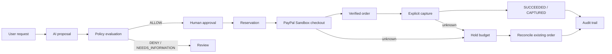

# INTENTRA — AI-Powered Purchasing & Financial Automation

> **Intelligent Spending. Human Control.**

INTENTRA is a human-governed purchasing workspace for teams that want AI help without handing AI financial authority. A user describes a purchase in natural language; INTENTRA turns that request into a structured proposal, evaluates deterministic policy, and keeps contract approval, checkout, capture, and audit evidence under explicit human control.

Built for the **PayPal AI Hackathon 2026**, INTENTRA demonstrates how AI-assisted purchasing can remain reviewable, policy-bound, and accountable from the first request through a verified provider outcome.

## Live Demo

- [**Open the live INTENTRA workspace**](https://intentra-web.vercel.app)
- [**Watch the hackathon demo on YouTube**](https://youtu.be/keaojS9wMp4)
- [**Browse the source on GitHub**](https://github.com/Cgarg547/Intentra)

[](https://youtu.be/keaojS9wMp4)

## Hackathon Demo

The demo follows a controlled purchasing journey:

```text
Natural-language request → AI proposal → intent contract → policy evaluation
→ human authorization → budget reservation → PayPal Sandbox checkout
→ verified capture → audit history
```

The demonstrated wireless-mouse payment was **USD 25.00 in PayPal Sandbox**. It was a test transaction—not a real-money payment. INTENTRA treats buyer approval separately from capture and relies on persisted, provider-verified state before presenting a payment as complete.

## Key Features

- AI-assisted structured purchase proposals
- Contracts, spending policies, and explicit human authorization
- Budget reservations, lifecycle history, dashboard, and audit timeline
- PayPal **Sandbox** checkout, server-side approval verification, separate capture, and reconciliation
- Owner-scoped access, idempotency, one-time capture claims, and duplicate-payment safeguards

## How INTENTRA Works



## Technology Stack

| Layer | Verified implementation |
| --- | --- |
| Web | Next.js 16.4.3, React 19.3.0, TypeScript |
| API | FastAPI 0.162.0, Python, Pydantic 2.14.2 |
| Data | PostgreSQL, SQLAlchemy 2.1.6, Alembic 1.20.1 |
| AI | Groq-compatible hosted provider support plus mock/local modes |
| Payments | PayPal Sandbox OAuth and Orders v2 via httpx 0.28.1 |
| Hosting | Vercel |

## PayPal Integration

INTENTRA keeps credentials and trusted merchant mappings server-side. It validates provider payee, amount, currency, order identity, and capture outcome. Ambiguous outcomes preserve budget and reconcile the existing order rather than blindly retrying.

Verified evidence — **PayPal Sandbox, not a live payment**:

| Evidence | Value |
| --- | --- |
| Amount | USD 25.00 |
| PayPal order | `23H101494S655791X` |
| Capture reference | `4AB74492EL1064825` |
| Payment / reservation | `SUCCEEDED` / `CAPTURED` |
| Provider outcome | `COMPLETED` |

## Getting Started

```sh
cd apps/api
python3 -m venv .venv
.venv/bin/python -m pip install -r requirements.txt
.venv/bin/alembic upgrade head # intended local database only
.venv/bin/python -m uvicorn main:app --host 127.0.0.1 --port 8000

cd ../web
npm ci
npm run dev -- --hostname 127.0.0.1 --port 3000
```

Use placeholders only: `DATABASE_URL`, `INTENTRA_FRONTEND_URL`, `AGENT_AI_PROVIDER`, `AGENT_LLM_ENABLED`, `GROQ_API_KEY`, `PAYPAL_SANDBOX_CLIENT_ID`, `PAYPAL_SANDBOX_CLIENT_SECRET`, `PAYPAL_SANDBOX_MERCHANTS`, `INTENTRA_API_URL`, and `INTENTRA_API_PROXY_TARGET`. Current migration head: `a3d8e1f4b7c2`.

Offline checks:

```sh
cd apps/api && .venv/bin/python scripts/offline_checks.py
cd ../web && npm run lint && npm exec tsc -- --noEmit && npm run build
```

## Security and Human Oversight

AI output is untrusted data, never payment authority. Contracts enforce owner, merchant, currency, amount, budget, and version boundaries. Confirmation, checkout, and capture are separate actions. Durable idempotency keys, one-time capture claims, provider-evidence validation, owner-scoped records, and audit events protect the workflow.

## Hackathon Innovation and Impact

INTENTRA separates AI assistance from financial authority, helping teams turn purchasing requests into reviewable, controlled workflows without treating an AI response as permission to spend.

## Current Status and Limitations

Implemented: controlled proposal-to-payment lifecycle, PayPal Sandbox checkout, capture, reconciliation, dashboard, and audit views. Demonstrated: one USD 25.00 Sandbox capture reconciled to a verified terminal state. This repository does not claim live PayPal processing, product discovery, retailer fulfillment, or production financial-compliance operations.

## License

[Apache License 2.0](LICENSE). See `NOTICE` for project notice.
