# INTENTRA architecture

The AI adapter may extract facts from an explicit request; it cannot authorize a
payment. Deterministic policy and a human confirmation are mandatory boundaries.

```mermaid
flowchart LR
  U[Authenticated owner] --> W[Next.js workspace]
  W --> A[FastAPI]
  A --> L["Local Ollama extraction<br/>or clearly labeled mock"]
  L --> P["Deterministic policy<br/>contract, merchant, currency, amount, budget"]
  P --> D[(PostgreSQL + append-only events)]
  P --> H[Explicit human confirmation]
  H --> R[Reservation + durable payment attempt]
  R --> O[PayPal Sandbox order creation]
  O --> B[Sandbox buyer approval]
  B --> V[Server fetches and validates existing order]
  V --> C[Separate one-time capture claim]
  C --> X[PayPal Sandbox capture]
  X --> E["Validated terminal result<br/>or UNKNOWN hold"]
  E --> D
```

Provider identifiers, request IDs and capture claims are persisted before and
around external operations. A timeout, malformed response or mismatched provider
evidence is not a reason to retry. INTENTRA retains the reservation and requires
review/reconciliation of the existing attempt.
